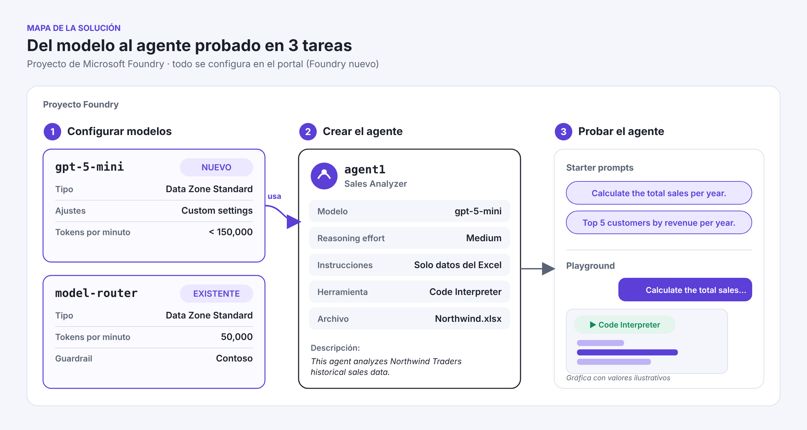
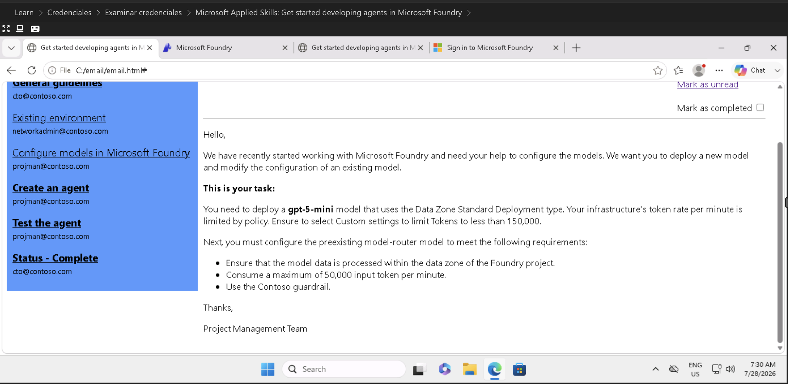
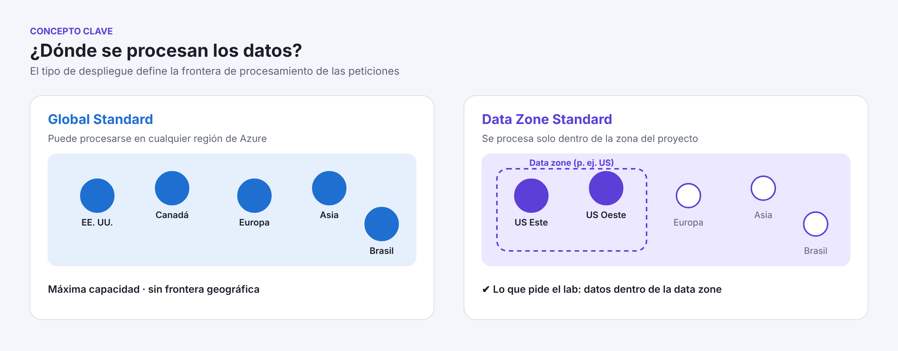
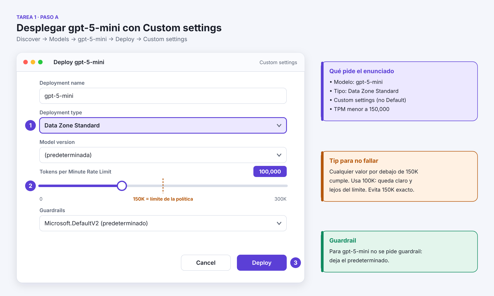
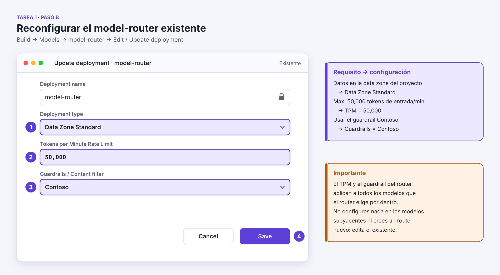
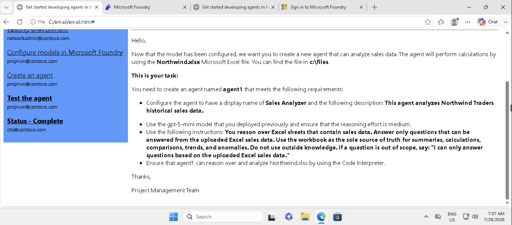
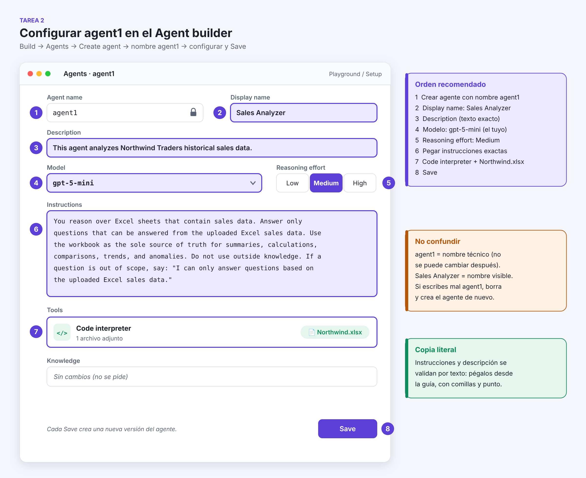
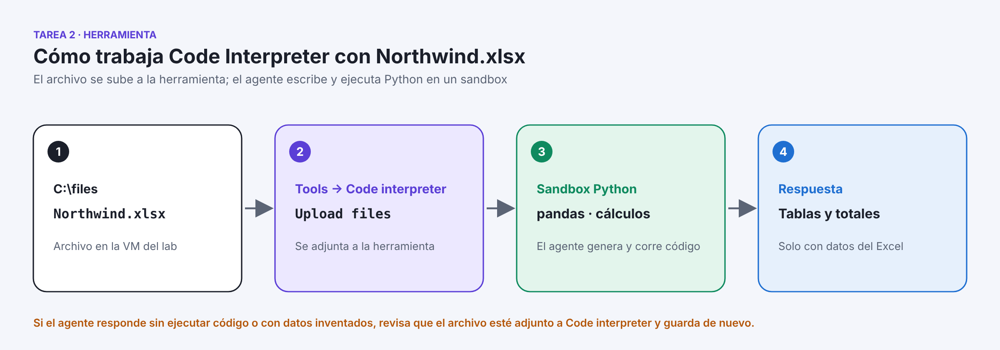
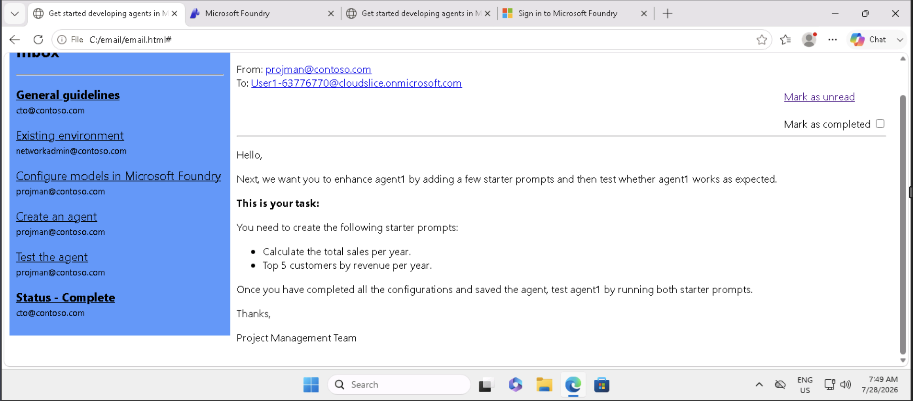
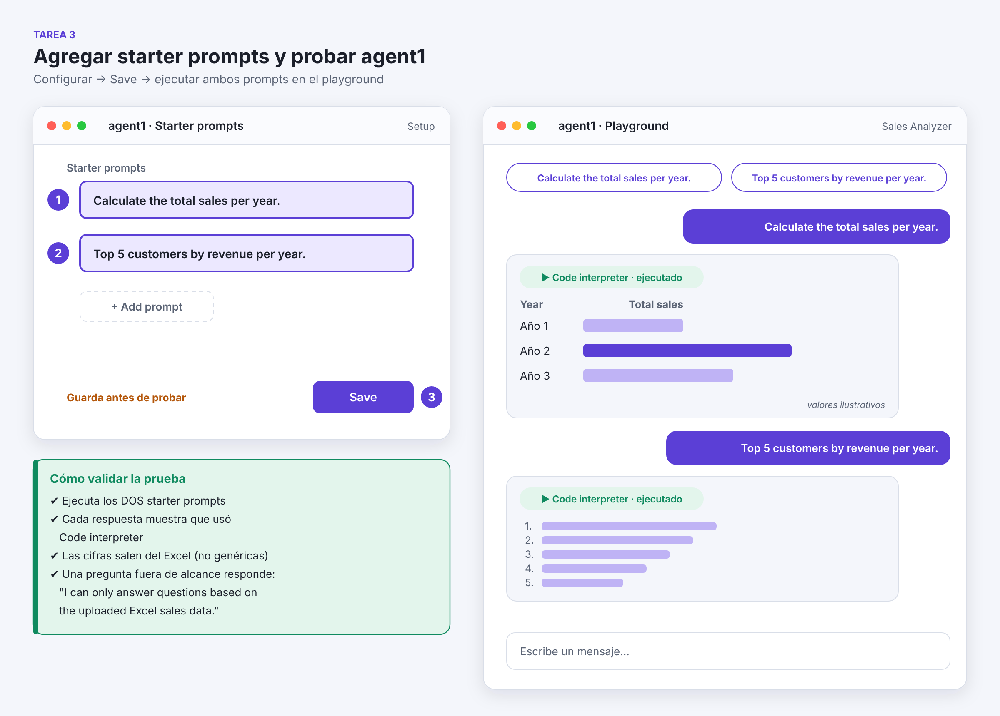

# Guía ilustrada · Applied Skills: Get started developing agents in Microsoft Foundry

> **Objetivo:** aprobar el laboratorio al 100% y contar con un instructivo reutilizable para partners.
> **Fuente técnica:** documentación oficial de Microsoft Learn (Microsoft Foundry, portal nuevo), verificada en noviembre 2026.
> **Credencial:** [Introducción al desarrollo de agentes en Microsoft Foundry](https://learn.microsoft.com/es-mx/credentials/applied-skills/get-started-developing-agents-in-microsoft-foundry/)

---

## Estructura del repositorio

```
foundry-agents-applied-skills/
├── README.md                     ← esta guía
└── img/
    ├── tarea1-enunciado.png      ← Tarea 1 · Configurar modelos (captura del lab)
    ├── tarea2-enunciado.png      ← Tarea 2 · Crear el agente (captura del lab)
    ├── tarea3-enunciado.png      ← Tarea 3 · Probar el agente (captura del lab)
    ├── 01-arquitectura.png       ← Ilustraciones de la guía
    ├── 02-deploy-gpt5mini.png
    ├── 03-model-router.png
    ├── 04-data-zone.png
    ├── 05-agent-builder.png
    ├── 06-code-interpreter.png
    ├── 07-starter-prompts.png
    └── src/                      ← Fuentes SVG editables de las ilustraciones
```

---

## 0. Antes de empezar

| ⚠️ Regla | Por qué importa |
|---|---|
| Lee los correos **General guidelines** y **Existing environment** | Describen las reglas del lab y lo que ya existe en el proyecto (por ejemplo, el `model-router` y el guardrail `Contoso`). |
| Usa el **portal nuevo de Foundry** | El toggle **New Foundry** debe estar activado. Los pasos de esta guía corresponden a esa versión. |
| Copia los **nombres y textos exactos** | `gpt-5-mini`, `agent1`, `Sales Analyzer`, la descripción, las instrucciones y los starter prompts se validan por texto. |
| No crees objetos de más | Edita el `model-router` existente, no despliegues otro. Crea un solo agente. |
| **Guarda (Save)** antes de probar | El evaluador revisa la versión guardada del agente. |

---

## 1. Mapa de la solución



| Tarea | Qué se configura | Resultado |
|---|---|---|
| **1 · Configurar modelos** | Despliegue nuevo de `gpt-5-mini` y ajuste del `model-router` existente | 2 despliegues en **Data Zone Standard** con límites de TPM |
| **2 · Crear el agente** | `agent1` con `gpt-5-mini`, reasoning **Medium**, instrucciones y Code Interpreter con `Northwind.xlsx` | Agente que analiza ventas solo con el Excel |
| **3 · Probar el agente** | Dos starter prompts y prueba en el playground | Respuestas calculadas con Code Interpreter |

---

## 2. TAREA 1 · Configurar modelos en Microsoft Foundry

### 📋 Enunciado del ejercicio



### Checklist de la tarea

- [ ] Despliegue de **`gpt-5-mini`** con tipo **Data Zone Standard**
- [ ] Desplegado con **Custom settings** y **TPM menor a 150,000**
- [ ] `model-router` **existente** en **Data Zone Standard**
- [ ] `model-router` con **TPM = 50,000**
- [ ] `model-router` con el guardrail **Contoso**

### Concepto clave: Data Zone Standard



**Data Zone Standard** procesa las peticiones solo dentro de la zona de datos del proyecto (por ejemplo, EE. UU. o UE). Con eso cumples el requisito de que "los datos se procesen dentro de la data zone del proyecto Foundry". **Global Standard** puede procesarlas en cualquier región de Azure.

### 2.1 Desplegar `gpt-5-mini` (Custom settings)



1. Entra a [ai.azure.com](https://ai.azure.com) con la cuenta del lab y abre el proyecto. Verifica que esté activado **New Foundry**.
2. Arriba a la derecha, selecciona **Discover** → **Models** y busca **`gpt-5-mini`**.
3. En la ficha del modelo: **Deploy** → **Custom settings**. No elijas *Default settings*.
4. Configura los campos:

| Campo | Valor |
|---|---|
| **Deployment name** | `gpt-5-mini` (el predeterminado) |
| **Deployment type** | **Data Zone Standard** ① |
| **Model version** | La predeterminada |
| **Tokens per Minute Rate Limit** | **100,000**, o cualquier valor **menor a 150,000** ② |
| **Guardrails** | El predeterminado (no se pide cambiarlo) |

5. **Deploy** ③. Espera a que el estado diga **Succeeded**.

> 💡 No uses 150,000 exacto: el enunciado dice "less than 150,000". Si la cuota del lab no te deja llegar a 100K, cualquier valor menor sirve.

### 2.2 Reconfigurar el `model-router` existente



1. Arriba a la derecha, selecciona **Build** → **Models** en el panel izquierdo.
2. Abre el despliegue **`model-router`** (ya existe) → **Edit** / **Update deployment**.
3. Configura:

| Requisito del enunciado | Campo | Valor |
|---|---|---|
| Datos procesados dentro de la data zone del proyecto | **Deployment type** | **Data Zone Standard** ① |
| Máximo 50,000 tokens por minuto | **Tokens per Minute Rate Limit** | **50,000** ② |
| Usar el guardrail Contoso | **Guardrails / Content filter** | **Contoso** ③ |

4. **Save** ④.

> ⚠️ El TPM y el guardrail del router se aplican a todos los modelos que el router usa por dentro, así que no se configuran en cada modelo subyacente. Doc: [Use model router](https://learn.microsoft.com/azure/foundry/openai/how-to/model-router)

> Si el campo **Deployment type** del router aparece bloqueado, revisa el correo *Existing environment*. No borres ni crees otro router sin que el lab lo indique.

---

## 3. TAREA 2 · Crear `agent1` (Sales Analyzer)

### 📋 Enunciado del ejercicio



### Checklist de la tarea

- [ ] Agente con nombre **`agent1`**
- [ ] Display name **`Sales Analyzer`**
- [ ] Descripción exacta
- [ ] Modelo **`gpt-5-mini`** (el desplegado en la Tarea 1) con **reasoning effort = Medium**
- [ ] Instrucciones exactas
- [ ] Herramienta **Code Interpreter** con **`C:\files\Northwind.xlsx`**
- [ ] **Save**

### 3.1 Configuración del agente



1. **Build** → **Agents** → **Create agent** (o **Build an agent**).
2. **Agent name:** `agent1` ①. Este nombre **no se puede cambiar después**; si te equivocas, elimina el agente y créalo de nuevo.
3. En la configuración del agente:

| # | Campo | Valor |
|---|---|---|
| ② | **Display name** | `Sales Analyzer` |
| ③ | **Description** | `This agent analyzes Northwind Traders historical sales data.` |
| ④ | **Model** | `gpt-5-mini` (el despliegue de la Tarea 1, no el `model-router`) |
| ⑤ | **Reasoning effort** (en la configuración del modelo, ícono ⚙️ junto al modelo) | **Medium** |

4. ⑥ **Instructions**: pega el texto exacto.

```text
You reason over Excel sheets that contain sales data. Answer only questions that can be answered from the uploaded Excel sales data. Use the workbook as the sole source of truth for summaries, calculations, comparisons, trends, and anomalies. Do not use outside knowledge. If a question is out of scope, say: "I can only answer questions based on the uploaded Excel sales data."
```

> 💡 Display name y descripción pueden estar en el panel de detalles del agente o en sus ajustes, según la versión del portal. Si no los ves en la vista principal, busca el ícono de edición junto al nombre del agente.

### 3.2 Agregar Code Interpreter con `Northwind.xlsx`



1. En **Tools** → **+ Add** → **Code interpreter** ⑦.
2. En la herramienta, selecciona **Upload files** y carga **`C:\files\Northwind.xlsx`** desde la VM del lab.
3. Confirma que el archivo aparece adjunto a **Code interpreter**. No lo agregues como *Knowledge* ni *File search*.
4. **Save** ⑧.

> El agente escribe y ejecuta Python en un sandbox sobre el Excel adjunto, por eso puede calcular totales, rankings y tendencias. Doc: [Code Interpreter tool](https://learn.microsoft.com/azure/foundry/agents/how-to/tools/code-interpreter)

---

## 4. TAREA 3 · Starter prompts y prueba de `agent1`

### 📋 Enunciado del ejercicio



### Checklist de la tarea

- [ ] Starter prompt: `Calculate the total sales per year.`
- [ ] Starter prompt: `Top 5 customers by revenue per year.`
- [ ] **Save** del agente
- [ ] Ejecutar **ambos** prompts en el playground

### 4.1 Agregar los starter prompts y probar



1. En la configuración de `agent1`, busca la sección **Starter prompts** (puede aparecer como *Conversation starters* o dentro de los ajustes del agente).
2. Agrega los dos textos exactos, con punto final:
   ```text
   Calculate the total sales per year.
   ```
   ```text
   Top 5 customers by revenue per year.
   ```
3. **Save** ③.
4. En el **Playground** del agente, haz clic en cada starter prompt (o pégalo) y envíalo.
5. Valida cada respuesta:
   - Indica que se ejecutó **Code interpreter**.
   - Las cifras salen del Excel: años reales del archivo y nombres de clientes de Northwind.
6. (Opcional) Haz una pregunta fuera de alcance, por ejemplo `What is the capital of France?`. Debe responder `I can only answer questions based on the uploaded Excel sales data.`

> Las cifras de las ilustraciones son ilustrativas. Las reales dependen del archivo `Northwind.xlsx` del lab.

---

## 5. Validación final antes de enviar

| # | Verificación | Dónde | ✔ |
|---|---|---|---|
| 1 | `gpt-5-mini` en **Data Zone Standard**, TPM < 150K, estado **Succeeded** | Build → Models | ☐ |
| 2 | `model-router` en **Data Zone Standard**, TPM **50K**, guardrail **Contoso** | Build → Models → model-router | ☐ |
| 3 | `agent1` con display name **Sales Analyzer** y descripción exacta | Build → Agents | ☐ |
| 4 | Modelo `gpt-5-mini` con reasoning **Medium** | agent1 → Model | ☐ |
| 5 | Instrucciones pegadas sin cambios | agent1 → Instructions | ☐ |
| 6 | Code interpreter con **Northwind.xlsx** adjunto | agent1 → Tools | ☐ |
| 7 | Dos starter prompts con texto exacto | agent1 → Starter prompts | ☐ |
| 8 | Agente guardado y ambos prompts ejecutados | Playground | ☐ |

---

## 6. Errores comunes y cómo resolverlos

| Síntoma | Causa probable | Solución |
|---|---|---|
| No aparece **Data Zone Standard** | Se eligió *Default settings* | Repite con **Deploy → Custom settings** |
| Error de cuota al desplegar | El TPM supera la cuota disponible | Baja el TPM (cualquier valor < 150K cumple) |
| No encuentro el guardrail **Contoso** | Se buscó en el despliegue de `gpt-5-mini` | Va en el **model-router**, en *Guardrails / Content filter* |
| El agente usa `model-router` | Se eligió el primer modelo de la lista | Cambia a **gpt-5-mini** y guarda |
| No aparece **Reasoning effort** | El modelo seleccionado no es de razonamiento | Selecciona `gpt-5-mini` y abre la configuración del modelo (⚙️) |
| Respuestas genéricas o inventadas | Northwind.xlsx no está adjunto a Code interpreter | Sube el archivo en la herramienta y guarda |
| El nombre del agente quedó mal | El nombre no se puede editar | Elimina el agente y créalo como `agent1` |
| Los starter prompts no se ven en el playground | No se guardó el agente | **Save** y recarga el playground |

---

## 7. Referencias oficiales (Microsoft Learn)

- [Credencial Applied Skills: Get started developing agents in Microsoft Foundry](https://learn.microsoft.com/es-mx/credentials/applied-skills/get-started-developing-agents-in-microsoft-foundry/)
- [Deploy Microsoft Foundry Models in the Foundry portal](https://learn.microsoft.com/azure/foundry/foundry-models/how-to/deploy-foundry-models)
- [Deployment types for Foundry Models](https://learn.microsoft.com/azure/foundry/foundry-models/concepts/deployment-types)
- [Foundry Models quotas and limits](https://learn.microsoft.com/azure/foundry/openai/quotas-limits)
- [Use model router for Microsoft Foundry](https://learn.microsoft.com/azure/foundry/openai/how-to/model-router)
- [Guardrails overview](https://learn.microsoft.com/azure/foundry/guardrails/guardrails-overview)
- [Agent development lifecycle](https://learn.microsoft.com/azure/foundry/agents/concepts/development-lifecycle)
- [Code Interpreter tool for Foundry agents](https://learn.microsoft.com/azure/foundry/agents/how-to/tools/code-interpreter)
- [Azure OpenAI reasoning models (reasoning effort)](https://learn.microsoft.com/azure/foundry/openai/how-to/reasoning)
